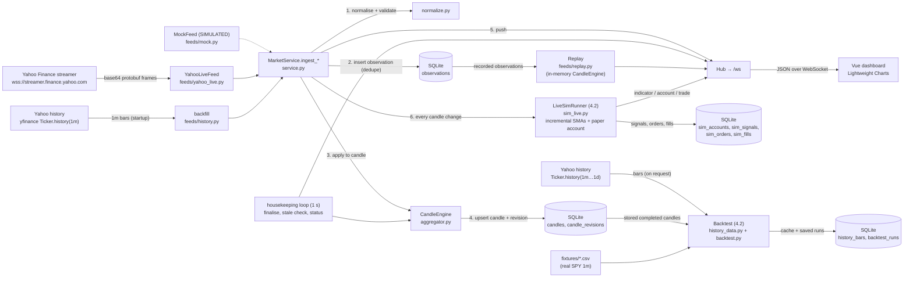

# Design notes — Live Market Workstation (Parts 4.1–4.2)

This document describes the system as it exists in the repository. Update it
when the code changes.

## 1. Data flow

Part 4.2 adds two consumers of the same candles: the live simulation runner
(listening to every candle change) and the backtester (reading completed
bars from SQLite, Yahoo history or a fixture). Both use the same
`indicators.py`, `strategy.py` and `accounting.py`.

Key point: **every source goes through one ingest path** (`MarketService`),
so de-duplication, revision and completeness rules are identical for live,
history and simulated data. The browser never talks to Yahoo; it talks only
to the FastAPI backend over `/ws` and `/api/*`.

## 2. Services and what each receives / returns

| Service | Receives from us | Returns | Used for |
|---|---|---|---|
| Yahoo streamer (`wss://streamer.finance.yahoo.com/?version=2`) | `{"subscribe": ["BTC-USD", …]}`, re-sent every 15 s | JSON frames `{"message": <base64 protobuf PricingData>}` | Live ticks |
| Yahoo history via `yfinance.Ticker.history(period="1d", interval="1m")` | symbol | pandas DataFrame of 1-minute OHLCV bars | Filling the chart at startup |
| Yahoo history for backtests, `Ticker.history(period, interval)` (4.2) | symbol, interval (1m/7d, 5m/60d, 15m/60d, 1h/730d, 1d/5y) | DataFrame of OHLCV bars; the still-forming last bar is dropped | Backtest data, cached in `history_bars` |

No API key is needed. `yfinance` is an independent open-source package, not
an official Yahoo API; the streamer is undocumented by Yahoo and may change.

**Why a custom client instead of `yfinance.AsyncWebSocket.listen()`:** its
listen loop catches connection errors, sleeps 3 s and reconnects internally,
so the application cannot see or display that the feed is down. Our client
(`feeds/yahoo_live.py`) speaks the same protocol, decodes frames with the
protobuf schema shipped in yfinance (`yfinance.pricing_pb2.PricingData`), and
reports each state change.

## 3. Feed states and data age

| State | Meaning | Shown as |
|---|---|---|
| `connecting` | opening the WebSocket | blue pill |
| `live` | connected and subscribed | green pill (purple **SIMULATED** for mock mode) |
| `stale` | connected but no message for `STALE_AFTER_SECONDS` (default 30) — e.g. market closed | amber pill + banner |
| `unavailable` | connect failed or connection dropped; retrying with backoff 2, 4, 8, 16, 30 s | red pill + banner, error text, retry count |
| `stopped` | feed mode `off` or shutdown | grey |
| `BACKEND OFFLINE` | the browser lost its socket to our backend (browser-side state) | red pill, "data shown is frozen" |

Every state change is written to `feed_events` and pushed to the UI's event log.

**Data age** = (server clock now) − (source timestamp of the newest tick for
the selected symbol). It measures how old the *market data* is, not how
recently the page redrew; the browser corrects for its own clock using
`server_time_ms` sent with each status message. **Source → backend** latency
= receipt time − source time of the latest tick.

## 4. SQLite schema

Created by `backend/app/db.py` (`python -m scripts.init_db`). WAL mode.

### `observations` — every distinct observation, once
| Column | Purpose |
|---|---|
| `id` | assigned on first receipt; also the replay order tiebreaker |
| `obs_key` UNIQUE | **observation identity** (see §5) |
| `kind` | `tick` (streamed) or `bar` (history) |
| `source` | `yahoo-ws`, `yahoo-history`, or `mock` |
| `symbol` | e.g. `BTC-USD` |
| `source_time_ms` | timestamp assigned by the source |
| `received_time_ms` | when this backend first received it |
| `price`, `day_volume` | tick fields (`day_volume` is Yahoo's cumulative session volume) |
| `bar_open…bar_volume` | bar fields |
| `payload_json` | the decoded source message, for audit |
| `duplicate_count`, `last_duplicate_ms` | later copies of the same identity |

### `candles` — current state of each candle
One row per `(symbol, interval, bucket_start_ms)`: OHLCV, `is_complete`,
`revision`, `origin` (`ticks` or `history`), `first_source_ms`/`last_source_ms`
(which ticks set open/close), `dv_min`/`dv_max` (for volume), `tick_count`,
`updated_received_ms`.

### `candle_revisions` — append-only history
One row per material change of a candle: `revision`, `reason`
(`new`, `update`, `out_of_order`, `late`, `finalize`, `backfill`,
`backfill_revision`), the `observation_id` that caused it, the OHLCV and
completeness after the change, and `recorded_ms`.

### `feed_events`
`ts_ms`, `source`, `state` (connecting / live / stale / unavailable /
history_loaded / history_unavailable / rejected / startup / shutdown), `detail`.

## 5. Rules for duplicates, revisions, out-of-order and completeness

**Identity / duplicates.** A tick's identity is
`source|tick|symbol|source_time|price|day_volume`. Yahoo can re-send the same
update (and our 15-second re-subscribe can cause repeats). A second copy hits
the UNIQUE constraint: the first copy and its original receipt time are
kept, `duplicate_count` is incremented, and the candle is **not** touched.
Two ticks at the same time with different prices are different observations.
A history bar's identity includes its values, so re-downloading an identical
bar is a duplicate, while a bar Yahoo has changed is a new observation.

**Bucket.** `bucket = floor(source_time / interval)` — the source time, not the
arrival time, decides which candle a tick belongs to.

**Out-of-order.** A tick whose source time is older than the candle's current
close tick: it can raise the high or lower the low (the trade happened), and
can set the open if it is the earliest, but it can **never overwrite a newer
close**. Recorded with reason `out_of_order`.

**Completeness.** A candle is *provisional* until wall-clock time passes
`bucket_end + FINALIZE_GRACE_SECONDS` (default 5 s); the 1-second
housekeeping loop then marks it complete (reason `finalize`). Provisional
candles are drawn hollow with a dashed **PROVISIONAL** tag; complete ones are
solid. The grace period absorbs small network delays.

**Late ticks.** A tick for a candle already marked complete is still applied
(reason `late`), the candle stays complete and its revision increases, so the
correction is visible rather than silently lost.

**Revisions.** Only material changes (OHLCV or completeness) increment
`revision` and append to `candle_revisions`; a tick that changes nothing but
the tick count updates the row without a new revision.

**History vs ticks.** History bars fill gaps and may revise earlier history
bars, but never overwrite a candle built from live ticks. A live tick can
extend a history candle (e.g. the current minute at startup).

**Volume.** Yahoo ticks carry the running session volume (`day_volume`), not
each trade's size. Candle volume = largest `day_volume` in the bucket − the
running total at the end of the previous candle (or the smallest value inside
the bucket for the first candle or after a session reset). Consequence: the
first candle after startup under-counts the volume before the first tick.

**Validation.** Messages without symbol/time/price, with non-positive or
non-finite prices, or timestamps > 5 min in the future are rejected, counted,
and logged (rate-limited) to `feed_events`. Prices arrive as float32 and are
rounded to Yahoo's `price_hint` decimals.

## 6. Replay

`feeds/replay.py` reads recorded observations ordered by
`(received_time_ms, id)` — the order the backend received them, including any
out-of-order delivery — and feeds them through the **same** `CandleEngine`
with an in-memory book, so replay never modifies stored candles. A simulated
clock (each observation's receipt time) drives candle completion. The UI can
stream a replay at 5×/20×/100×/instant speed (gaps capped at 1 s so a closed
market does not stall it); `GET /api/replay/verify` rebuilds every candle and
compares OHLCV + completeness with the stored rows. Revision numbers can
differ by one at most where a tick arrived during the ≤1 s window between a
candle becoming due and the housekeeping loop finalising it; OHLCV and
completeness still match.

## 7. Browser ↔ backend protocol (`/ws`)

Server → client: `hello` (symbols, interval, status, recent events),
`snapshot` (candles, indicator points, SMA windows and the simulated account
for the subscribed symbol), `candle` (one changed candle + reason), `tick`,
`status` (every 2 s and on change), `event`,
`replay_started` / `replay_candle` / `replay_finished`;
4.2: `indicator` (one point, confirmed or provisional), `indicators` (full
series after a rebuild), `account` (every 2 s), `trade` (after a signal).
Client → server: `subscribe {symbol}`, `replay_start {symbol, speed}`,
`replay_stop`, `ping`.

REST: `/api/health`, `/api/config`, `/api/status`, `/api/candles`,
`/api/candles/{symbol}/{bucket_start_ms}/revisions`, `/api/observations`,
`/api/events`, `/api/stats`, `/api/replay/verify`, `POST /api/feed/fault`.
4.2: `/api/indicators`, `/api/indicators/verify`, `/api/sim/account`,
`POST /api/sim/reset`, `/api/backtest/options`, `POST /api/backtest`,
`/api/backtest/runs`, `/api/backtest/runs/{id}`.

## 8. Design decisions and alternatives

| Decision | Alternative considered | Why |
|---|---|---|
| Build candles from ticks in the backend | Poll `history(interval="1m")` every few seconds | Ticks give a truly live provisional candle and let us show revisions/out-of-order; polling hides them and is rate-limited. |
| Own WebSocket client, yfinance protobuf schema | `yfinance.AsyncWebSocket.listen()` | Need visible outage states (see §2). |
| One ingest path for all sources | Separate code per source | Same rules everywhere; replay can prove equivalence. |
| Append-only `candle_revisions` | Overwrite candle rows only | Revisions must be preserved and explainable. |
| Wall-clock finalisation + grace | Finalise when the next bucket's first tick arrives | Illiquid symbols may not tick for minutes; a clock rule is predictable. |
| Lightweight Charts v4 | Chart.js financial plugin, ECharts | Built for OHLC + volume, small, handles live `update()`. |
| Default symbols BTC-USD, AAPL, SPY | Equities only | BTC-USD trades 24/7, so live streaming can be shown outside US market hours. |
| Mock feed labelled SIMULATED | No offline mode | Tests and development without network or open markets; never confusable with real data. |

## 9. Known limitations

* Only 1-minute candles are built (interval is configurable, history backfill is 1m only).
* Yahoo's streamer is unofficial; field availability (e.g. `day_volume` for some instruments) and timing are not guaranteed. Some instruments may not report volume; their volume bars stay at 0.
* First candle after startup under-counts volume (no earlier running total).
* History bars never replace tick-built candles, so a tick-built candle's volume comes only from `day_volume` deltas.
* Candle completion uses the backend's wall clock; a badly skewed machine clock would finalise too early or late.
* Single-process backend; SQLite access is serialised with a lock.

---

# Part 4.2 — indicators, simulated trading, backtesting

## 10. Indicators (`backend/app/indicators.py`)

* **SMA(n)** at bar *i* = arithmetic mean of the closes of bars *i−n+1 … i*
  (`math.fsum` / n). Undefined until *n* completed bars exist.
* Chosen windows: **SMA 10 and SMA 30** on 1-minute candles (`SMA_FAST`,
  `SMA_SLOW`). Fixed in advance as common short/long pair; not tuned on data.
* Two implementations: `sma_batch` (recompute from a list) and
  `IncrementalSMA` (rolling window, one bar at a time, plus `peek()` for a
  provisional value that does not change state). Tests check both against
  **pandas `Series.rolling(n).mean()`** on the real SPY fixture and against
  each other; the live dashboard has a *Verify live SMA = batch* button
  (`/api/indicators/verify`) that compares the running incremental state with
  a batch recomputation from SQLite at the same candle.
* **Crossover:** diff = SMA_fast − SMA_slow. *Up* when diff becomes > 0 and the
  last non-zero diff was < 0; *down* is the mirror. diff == 0 (touching) is
  not a crossover; the first bar where both SMAs exist is not a crossover.
* **Unfinished candles.** Confirmed SMA values and crossovers come only from
  completed candles. While a candle is forming, a *provisional* value is
  computed as if it closed at the current price. It is drawn faded, a
  provisional crossover gets a grey "?" marker, and the strategy never trades
  it. A provisional crossover can disappear before the candle completes
  (tested). No provisional value is shown while the previous candle is still
  in its finalisation grace period, because the window would otherwise skip
  that candle.
* **Gaps** (feed outages, market closures): the SMA treats the bars on either
  side of a gap as consecutive. The runner counts gaps; backtests report them.

## 11. Simulated account and execution assumptions (`accounting.py`)

| Assumption | Value / rule |
|---|---|
| Instruments / direction | one account per symbol; long-only, no shorting, no leverage |
| Order type | market orders only |
| Sizing | buy: `SIM_ALLOCATION` (default 100 %) of cash, fee included, fractional qty rounded down to 6 dp; sell: whole position |
| Fill price — live | latest observed trade price when the crossover is confirmed (its source time is stored as `ref_source_ms`) |
| Fill price — backtest | open of the bar after the signal bar |
| Slippage | `SIM_SLIPPAGE_BPS` = 5 bps against the trader (buy higher, sell lower) |
| Fee | `SIM_FEE_BPS` = 10 bps (0.10 %) of notional per fill, paid in cash |
| Cost basis | average cost, fees excluded |
| Realized P&L | (fill price − average cost) × qty on sells, before fees |
| Unrealized P&L | (mark − average cost) × qty; live mark = latest tick (the current candle may be unfinished) |
| Identity (tested) | equity − initial cash = realized + unrealized − fees |
| Rejections | not enough cash, nothing to sell, qty rounds to 0 → order rejected, never partially filled |

The account is persisted as fills (`sim_fills`) and rebuilt by replaying them
through `Account.apply_fill` on startup (tested), so the stored rows are the
source of truth. Changing any strategy/cost setting starts a new account; the
old one is kept (`active = 0`). *Reset account* does the same on demand.

## 12. Strategy (`strategy.py`) and live paper trading (`sim_live.py`)

| Confirmed crossover | Position | Action |
|---|---|---|
| up | flat | buy |
| up | long | skip ("already long") |
| down | long | sell all |
| down | flat | skip ("no position, long-only") |

Live flow per candle change from `MarketService`:

1. A candle **became complete** (reason `finalize`) and is newer than the last
   one used → push its close into the incremental SMAs → confirmed point →
   if there is a crossover and the candle ended after the account was
   created, record a `sim_signals` row, place the order and fill it.
2. A candle is **still forming** and directly follows the last confirmed one →
   provisional point only.
3. A candle that is **older than or equal to** the last one used changed
   (late tick, history revision, a delayed tick creating a missing candle) →
   mark the SMA state dirty and rebuild it from SQLite (debounced 0.5 s; done
   immediately if needed sooner). Decisions already taken are not redone; the
   signal row keeps the SMA values that were used.
4. Candles that arrive already complete from history backfill update the
   indicators but are never traded (they describe the past).

## 13. Backtesting (`backtest.py`, `history_data.py`)

Event-driven, one bar at a time:

1. fill any order decided at the previous bar's close at **this bar's open**;
2. update SMAs with **this bar's close**, detect a crossover, decide;
3. mark equity at this close.

So a decision at bar *i* uses bars 0…*i* only, and execution uses bar *i+1*'s
open. A signal on the final bar is reported as unexecuted. **Look-ahead test:**
running on data truncated at bar *k*, or with all bars after *k* replaced by
very different prices, leaves every signal and fill before *k* unchanged.

Data sources, all returning **completed bars only**:

| Source | What | Notes |
|---|---|---|
| `fixture` | `backend/data/fixtures/spy_1m_2026-11-12.csv` — 390 real SPY 1-minute bars, 9:30–16:00 ET, recorded by this app on 2026-11-12 (from Yahoo history), no gaps | offline, used by tests and CI |
| `stored` | completed candles in `candles` | whatever the app recorded; often gappy |
| `yahoo` | `Ticker.history` for 1m…1d, cached in `history_bars` | the still-forming last bar is dropped; if download fails, the cache is used and the run says so |

Metrics: final equity, total return, **buy-and-hold benchmark** (buy at the
open of bar index *slow*, same costs), max drawdown, round trips, win rate,
average trade return, fees, slippage cost, time in market, gaps. Every run is
saved in `backtest_runs` with its parameters, data description and results.

What a result can and cannot establish is shown next to every run: one
instrument and one period; instruments chosen today exist today
(survivorship); windows not tuned (tuning many and keeping the best would
overfit); fills assume the next open is available with only modelled
slippage; a past result is not a forecast.

## 14. Schema additions (schema version 2)

`history_bars` (backtest data cache, PK symbol+interval+time),
`backtest_runs` (params, data, metrics, full result JSON),
`sim_accounts` (one active per symbol; windows and cost settings),
`sim_signals` (every confirmed crossover: candle, SMA values, action, note,
order), `sim_orders` (side, status, reason, reject reason),
`sim_fills` (qty, reference price and its source time, executed price, fee,
realized P&L). See `backend/app/db.py`.

## 15. Part 4.2 limitations

* Long-only, market orders, one position per symbol; no stop-loss.
* Live fills use the last observed price, which can be a few seconds old
  (Yahoo delay ~3 s); backtest fills use the next bar's open. The two are not
  identical by design and are documented here.
* Gaps are bridged by the SMA, not filled.
* A candle that appears behind the latest one (delayed data) updates the SMAs
  after a rebuild, but a crossover it would have caused is not traded later.
* The fixture is one trading day of one ETF; conclusions from it are narrow.
